- 🔭 I’m currently working on **Nivida Manthan**

- 🌱 I’m currently learning **Data Engineering, Machine Learning, LLMs, RAG, AI Agents, SQL, Data Pipelines, MLOps, System Design and DSA in Python**

- 👯 I’m looking to collaborate on **Open-source Data Science, Data Engineering & AI projects**

- 🤝 I’m looking for help with **Data Engineering, LLM Engineering & MLOps**

- 👨‍💻 All of my projects are available at [https://nihal-os.vercel.app/](https://nihal-os.vercel.app/)

- 💬 Ask me about **Python, Pandas, NumPy, Data Analysis, Web Scraping, ETL Pipelines, MongoDB, AI/LLMs and Data Visualization**

- 📫 How to reach me **www.linkedin.com/in/nihal-khedekar-386260375**

- ⚡ Fun fact **I enjoy turning complex problems into practical systems and exploring how data, AI, and human decision-making connect.**

               

